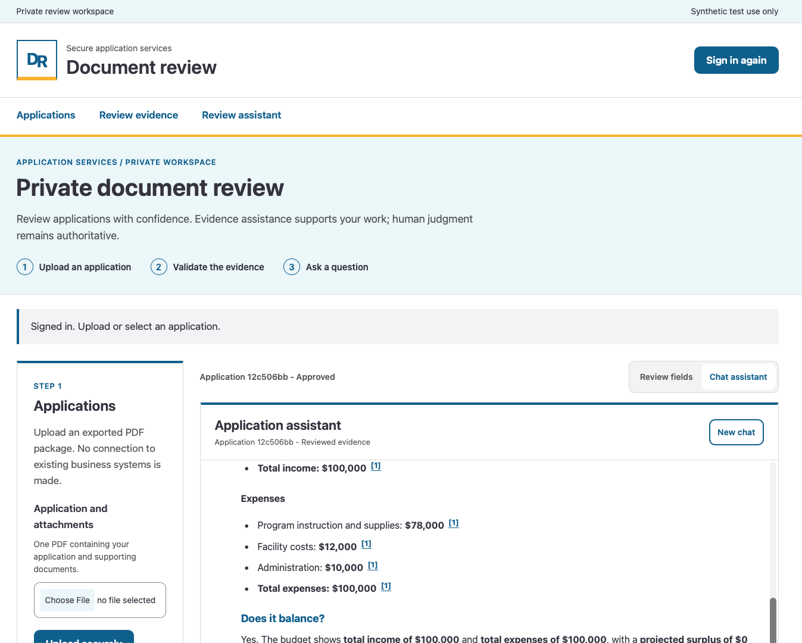

# PoC: Highly regulated private IQ

An Azure proof of concept for human-led review of manually exported PDF application packages. **Synthetic documents only.** Caseworkers upload documents through a private, Entra-authenticated portal. Content Understanding proposes fields, confidence and source evidence. This PoC supports owner self-review: users assigned both Caseworker and Reviewer roles correct and confirm every field before publication.

For case-scoped questions, the API supplies case-authorized evidence and validates citation IDs. Answers remain suggestions requiring source verification. **People make the decisions:** there are no business-system connectors or automated eligibility decisions.

## Architecture


| Component | Purpose |
| --- | --- |
| Microsoft Entra ID | Single-tenant SPA/API authentication, delegated scope and Caseworker/Reviewer roles. |
| Azure Container Apps | Private portal, API and continuously running extraction worker. |
| Blob Storage | Dedicated containers for originals, review state, approved PDFs and corrected field evidence. |
| Content Understanding | Configurable extraction schema, confidence and source references. |
| Azure AI Search / Foundry IQ | Private indexing and retrieval of human-approved evidence. |
| Azure OpenAI | Direct private chat completion with API-supplied case evidence and validated citation IDs; no tools. |
| Azure Container Registry | Private builds and immutable-digest runtime images. |
| Bicep + Azure CLI | Modular infrastructure and explicit native service/identity handoffs. |

## Example UI



## Run the demo

[Getting started](docs/getting-started.md) is the canonical guide. Every infrastructure change needs a reviewed what-if and explicit approval.

1. Clone the repo, sign in with `az login`, then run `./run.sh -x check-deps` (needs `az` with Bicep, and `jq`).
2. Copy each `infra/bicep/examples/<stage>.example.bicepparam` to an ignored `<stage>.local.bicepparam` and set the project name, approved region, admin user and models.
3. Preview, then install:

    ```bash
    ./run.sh -x build
    export PARAMETERS_FILE=infra/bicep/examples/main.local.bicepparam LOCATION=<approved-region>
    ./run.sh -x what-if
    ./run.sh -x install   # shows what-if, then requires a typed "yes"
    ```

Here is the entire help and options:

   ```bash
   usage: run.sh [options]
   
       -x  check-deps | build | what-if | install | show
       -h  Show help.
    
   Actions:
       check-deps  Check installed Azure CLI, Bicep and jq (no sign-in).
                   Bicep may be on PATH or in the existing Azure CLI bin directory.
       build       Compile and validate the selected template locally, without output.
                   Also validate PARAMETERS_FILE when supplied; never write JSON.
       what-if     Preview resource changes (resource IDs only; no property values).
       install     Run what-if, then require one explicit "yes" before deployment.
       show        Show deployment name and provisioning state only.
    
   Environment:
       TEMPLATE_FILE     Default: infra/bicep/main.bicep
       PARAMETERS_FILE   Required for what-if/install: ignored local .bicepparam file
       LOCATION          Required explicitly for what-if/install/show
       DEPLOYMENT_SCOPE  subscription (default) | group
       RESOURCE_GROUP    Required only for group scope; must already exist
       DEPLOYMENT_NAME   Default: private-review
    
   Relative paths are resolved from the repository, not the current directory.
   No config files are sourced. Authenticate/select your subscription separately.
   LOCATION selects subscription deployment metadata location; the parameter file
   must independently select approved resource/model processing locations.
   Review template permissions, stage controls and what-if before approving.
   This runner never creates a group separately, deletes resources, grants roles,
   registers providers, enrolls Tailscale or changes consent.
    
   Example:
       LOCATION=canadacentral PARAMETERS_FILE=infra/bicep/local.bicepparam \
         ./run.sh -x what-if
   ```

4. Complete the remaining stages in the guide: platform, private image build, runtime, Entra apps, Content Understanding and Search objects. These native handoffs are never automatic.
5. From a private-network host, map the portal hostname to its Private Endpoint IP (hosts entry or exact-hostname split DNS) and open the portal.
6. Sign in, upload one synthetic PDF, confirm every field, publish as Reviewer, run both Search indexers and ask a case-scoped question.

Use a new private PoC foundation, an approved region and Private Endpoints only; never reuse another project's resources. The runtime mode is synthetic-only ([constraints](docs/highly-regulated-scenario.md#synthetic-only-poc)). The portal, API and worker share one process and identity ([limitations](docs/highly-regulated-scenario.md#authentication)). Review temporary operator grants after setup ([Rights granted](docs/getting-started.md#rights-granted)).

## Repository

| Location | Contents |
| --- | --- |
| [`infra/bicep/`](infra/bicep/README.md) | Subscription entry point, focused modules and sanitized parameter examples. |
| `run.sh` | `check-deps`, `build`, `what-if`, `install`, `show`; native Azure CLI deployment commands. |
| `app/ReviewPortal/` | Portal/API and extraction worker. |
| `app/ReviewPortal.Tests/` | Local application checks with synthetic inputs/mocked services. |
| [Scenario](docs/highly-regulated-scenario.md) | Application flows, authorization and synthetic-use constraints. |
| [Development](docs/development.md) | Local tools and execution-host guidance. |
