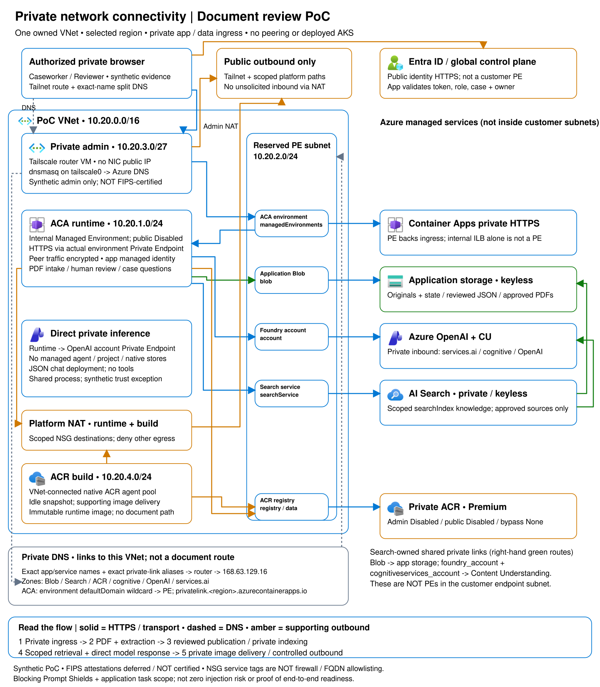

# PoC: Highly regulated private IQ

An Azure proof of concept for human-led review of manually exported PDF application packages. Caseworkers upload documents through a private, Entra-authenticated portal. Content Understanding proposes fields, confidence and source evidence; reviewers correct and confirm every field before publication. Case-scoped questions use only approved evidence, with source references. **People make the decisions:** there are no business-system connectors or automated eligibility decisions.

## Architecture




| Component | Purpose |
| --- | --- |
| Microsoft Entra ID | Single-tenant SPA/API authentication, delegated scope and Caseworker/Reviewer roles. |
| Azure Container Apps | Private portal, API and continuously running extraction worker. |
| Blob Storage | Separate originals, review state, approved PDFs and corrected field evidence. |
| Content Understanding | Configurable extraction schema, confidence and source references. |
| Azure AI Search / Foundry IQ | Private indexing and retrieval of human-approved evidence. |
| Azure OpenAI | Direct private JSON chat completion using only case-authorized evidence; no tools or managed agent. |
| Azure Container Registry | Private builds and immutable-digest runtime images. |
| Bicep + Azure CLI | Modular infrastructure and explicit native service/identity handoffs. |

## Get started

Follow [getting started](docs/getting-started.md), the canonical deployment guide. `infra/bicep/` is the infrastructure source; `run.sh` is a small Bash entry point:

```bash
./run.sh -x check-deps
./run.sh -x build
# After choosing the target and creating reviewed local parameters:
PARAMETERS_FILE=infra/bicep/examples/main.local.bicepparam \
  LOCATION="$APPROVED_REGION" ./run.sh -x what-if
```

Installation requires approval of the exact target and changes. The script does not grant Microsoft Graph permissions, register native data-plane objects or silently adopt existing resources. In Copilot App/CLI, **"Deploy the platform"** follows the same guide.

Use a **new private PoC foundation**, an explicitly approved supported region and one approved private-network-connected execution host. Do not reuse or modify another project's infrastructure. App/data ingress uses Private Endpoints only, with public network access disabled. A separately approved controlled outbound NAT public IP is allowed; it does not expose inbound access or permit unrestricted egress.

This PoC uses the explicitly approved **synthetic-only attestation-deferred** runtime mode: `runtime.attestation_mode = 'synthetic_poc_attestation_deferred'`, `runtime.approved = false`, and all three encryption evidence strings exactly empty. Private networking, encryption controls, real SPA/API authorization, model processing boundaries, immutable images and human review remain required.

The portal/API/worker share one process and one replica for this synthetic PoC. Owner and Reviewer checks enforce publication; they are not parser/process privilege isolation. Both full approved PDFs and corrected fields remain indexed. Removed managed-agent resources require a separately approved cloud cleanup; source changes do not delete them.

**Use synthetic documents only.** FIPS 140-3 is a requirement to assess for any future real deployment; this PoC makes no certification claim.

## Repository

| Location | Contents |
| --- | --- |
| [`infra/bicep/`](infra/bicep/README.md) | Subscription entry point, focused modules and sanitized parameter examples. |
| `run.sh` | `check-deps`, `build`, `what-if`, `install`, `show`; native Azure CLI deployment commands. |
| `app/ReviewPortal/` | Portal/API and extraction worker. |
| `app/ReviewPortal.Tests/` | Local application checks with synthetic inputs/mocked services. |
| [Scenario](docs/highly-regulated-scenario.md) | Application flows, authorization and synthetic-use constraints. |
| [Development](docs/development.md) | Local tools and execution-host guidance. |
| `workspace/` | Disconnected inherited Fabric sample; not part of application deployment. |
