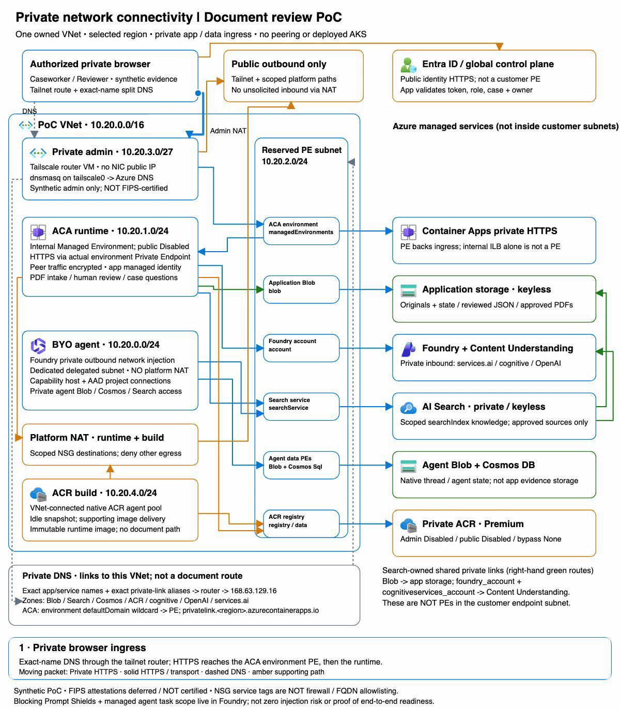

# Private document review architecture

The existing canonical [SVG](private-document-review.svg) and
[editable Excalidraw](private-document-review.excalidraw) describe the current
Container Apps solution. They are linked from the repository README and scenario
guide. Three marked flow directions separate intake/review, publication/indexing
and server-authorized case questions. The disconnected inherited Fabric sample
is deliberately outside the app's retrieval path.

`generate-private-document-review.py` is the offline editable layout/content
source. It emits both artifacts with embedded, unchanged official Microsoft SVG
icons. See [icon provenance and terms](icons/NOTICE.md) and the hashed
[source manifest](icons/manifest.json). No network or cloud access is involved.

On the authoritative macOS authoring host, using the existing Python/Pillow
installation and system Helvetica:

```sh
python3 docs/diagrams/generate-private-document-review.py
python3 docs/diagrams/generate-private-document-review.py --check
```

The check verifies deterministic output, unique element IDs, nonzero editable
text/image dimensions, icon hashes, text extents and orthogonal connectors that
do not cross service cards. Inspect the SVG at full size after content/layout
changes; structural checks do not replace visual review. Use the approved
[Microsoft Excalidraw instance](https://aka.ms/excalidraw) only if interactive
editing is needed; these artifacts do not require uploading private content.

The diagram is **not** a deployment-status dashboard, end-to-end readiness proof
or FIPS certification. FIPS attestations are deferred for this synthetic PoC.
Native scope instructions and model Prompt Shields are real architecture
boundaries, not proof of zero injection risk: Responses indirect-detector
coverage has not been independently established. Temporary runtime incidents,
agent versions, physical resource IDs and customer identity details are
intentionally excluded. Selected processing boundaries, preview service behavior and acceptance
remain independent verification gates.

## Separate network connectivity view

The [network SVG](private-network.svg) and [editable network Excalidraw](private-network.excalidraw)
add a subnet / Private Endpoint / DNS view without replacing or modifying the
canonical application architecture. Solid arrows represent request/transport
directions (responses return on the same private path); dashed arrows are DNS,
not document movement. Azure services drawn to the right are managed services,
not resources hosted inside the customer endpoint subnet.



The [39-second looping GIF](github-gifs/PrivateNetworkFlow.gif) keeps the network
visible while highlighting one route with an eased moving packet and staged
narration. A three-second closing pause separates loops. Original PDF storage,
human-approved publication, Search-owned shared private links, scoped retrieval,
Foundry response, BYO agent connections and private image delivery are separate
beats. A highlighted path is an architecture explanation, not a replay of
customer traffic or proof that that stage passed acceptance.

### Topology evidence and limits

Read directly for this view:

- [`connectivity/main.tf`](../../infra/connectivity/main.tf) and its
  [DNS/route guidance](../../infra/connectivity/README.md): private admin VM,
  separate connectivity NAT, exact-hostname split DNS to `dnsmasq` on
  `tailscale0`, then Azure DNS. Only the reserved endpoint prefix is advertised,
  not the whole VNet. The client must not query `168.63.129.16` directly.
- [`foundation/network.tf`](../../infra/foundation/network.tf),
  [`foundry.tf`](../../infra/foundation/foundry.tf) and
  [`capability.tf`](../../infra/foundation/capability.tf): dedicated agent,
  runtime and build subnets; scoped runtime/build platform egress; linked
  private zones; private inbound Foundry endpoints; outbound agent network
  injection; capability-host AAD connections to native Blob/Cosmos/Search.
- [`highly-regulated/runtime.tf`](../../infra/highly-regulated/runtime.tf),
  [`main.tf`](../../infra/highly-regulated/main.tf) and
  [`private-dependencies.tf`](../../infra/highly-regulated/private-dependencies.tf):
  actual `managedEnvironments` PE, app DNS wildcard targeting the PE rather
  than internal ILB, encrypted peer traffic, app MI, private/keyless services,
  ACR access controls, and Search-owned Blob / Content Understanding shared
  private links (`blob`, `foundry_account`, `cognitiveservices_account`).
- [`acr-build/main.tf`](../../infra/acr-build/main.tf): native VNet-connected
  ACR pool, a supporting image-build path, not document processing.
- Cross-checked standalone Bicep: [`foundation/network.bicep`](../../infra/bicep/foundation/network.bicep),
  [`foundation/private-network.bicep`](../../infra/bicep/foundation/private-network.bicep),
  [`scenario/hosting.bicep`](../../infra/bicep/scenario/hosting.bicep),
  [`runtime-dns.bicep`](../../infra/bicep/scenario/runtime-dns.bicep),
  [`private-links.bicep`](../../infra/bicep/scenario/private-links.bicep) and
  [`acr-build/main.bicep`](../../infra/bicep/acr-build/main.bicep). These are
  alternative deployment sources, not a second deployed network.

Focused read-only inspection of **owned** VNet/subnets/endpoint groups/private
DNS on 2026-10-10 UTC confirmed the selected region, the five depicted subnet prefixes,
separate connectivity vs runtime/build NAT associations, no NAT on the agent
subnet, and no attached custom route table on these subnets. The app DNS
wildcard targeted the Managed Environment PE. Physical addresses, hostnames,
resource names and IDs are deliberately not embedded; `10.20.*` prefixes are
illustrative layout CIDRs, not reusable deployment configuration. Client
route/ACL/DNS approval still requires its own verification.

Entra/global control-plane sign-in is **public identity HTTPS**, never a
customer Private Endpoint. Outbound-only NAT public IPs do not create public
app ingress. Runtime/build destination-scoped NSG/service-tag rules are **not**
a firewall or FQDN allowlist. The separate synthetic admin subnet retains its
documented default outbound access for packages and Tailscale coordination,
relays and traversal; it is not presented as production-controlled egress.
Neither Tailscale nor this synthetic PoC is a FIPS certification. No peering,
firewall, deployed AKS or connected Fabric is implied. Foundry owns Blocking
Prompt Shields and native task-scope instructions, not app-side safety
classifiers. `TaskAdherence` is not enabled: processing-residency suitability has
not been reviewed for the selected boundary, and user-intent alignment is not
application-domain scope enforcement. Indirect-detector coverage and end-to-end
readiness are not established by this illustration.

### Rebuild and verify locally

[`generate-private-network.py`](generate-private-network.py) reuses the existing
offline geometry/icon helpers without changing the canonical diagram.
[`network-animation/`](network-animation/) is an isolated Remotion project:
plain timeline data, pure frame interpolation, root composition and embedded
offline SVG scene. It has no hosted webapp, runtime deployment or external
assets. Existing Python/Pillow + Helvetica and Node/ffmpeg are required.

```sh
python3 docs/diagrams/generate-private-network.py
cd docs/diagrams/network-animation
npm ci --no-audit --no-fund
npm run build
npm run check
```

`build` renders local video and encodes a palette-optimized GIF with ffmpeg.
Only GIF, source and verification manifest are tracked; video/dependencies/
visual-review frames are ignored. `check` verifies deterministic SVG /
Excalidraw / scene output, official icon hashes, black explicitly-sized text,
transparent containers, orthogonal connectors avoiding service cards, timeline
continuity, response directions and bounds, source/output SHA-256, dimensions,
frame durations, infinite loop, meaningful distinct frames and size (<12 MiB).
The GIF has 468 frames at 12 fps (39 seconds), with alternating centisecond
durations due to the GIF format. Still inspect the full-size SVG and
representative ingress/publication/response/build/pause frames after changes;
structural checks do not replace visual review.

### Public inspiration, tooling and licensing

- Inspected representative frames of the public
  [MiraOverviewFlow.gif](https://raw.githubusercontent.com/dcasati/mira/main/docs/diagrams/github-gifs/MiraOverviewFlow.gif)
  (960×700, 780 frames) for its persistent architecture, selected-route motion,
  staged explanation and loop/reset approach. No artwork or GIF frames were
  copied into the new assets; the downloaded reference stays in ignored scratch.
- Used the **actual Remotion animation approach** from
  [raykao/explainer-content](https://github.com/raykao/explainer-content/tree/d56f0d9d2ba5cdcb36b13d3ac3d76f50e0cfcad5):
  its `remotion-explainer-core` contract, `pod-to-pod-traffic` timeline /
  interpolation helpers and composition registration informed the separate
  `timeline-data`, `animation-utils`, composition and root files. This is a
  working Remotion 4.0.500 render, not merely a reference to that repository.
  Its repository has **no root license**, and its video package is
  `UNLICENSED`; no upstream implementation, illustrations, music or assets
  were copied. All scene and animation implementation here is independently
  authored. Framework API usage does not grant rights to upstream artwork.
- [Remotion's license](https://www.remotion.dev/license)
  permits individual/small-organization/evaluation use and requires a company
  license for applicable larger for-profit use. This is a local PoC evaluation;
  assess that license before organizational/commercial reuse. Dependency
  packages retain their own bundled notices; they are not vendored.
- Official Microsoft assets are reused unchanged with the existing
  [terms/provenance](icons/NOTICE.md) and [hash manifest](icons/manifest.json).
  No private repository content was submitted to a public service.
