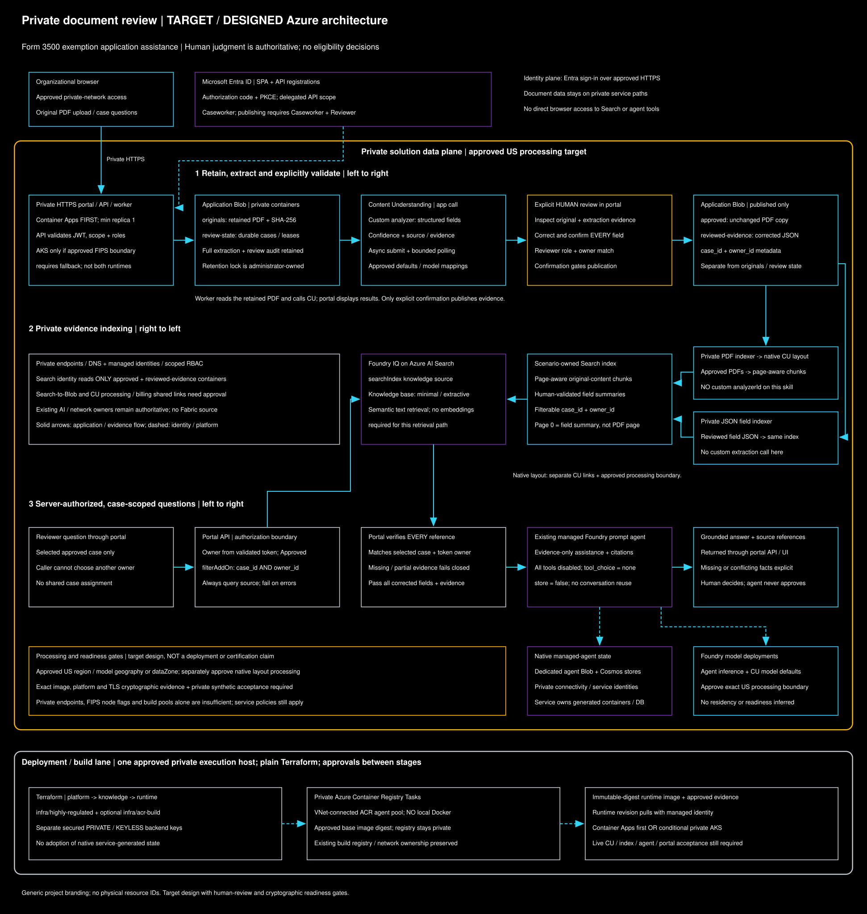

# Private document review for highly regulated environments

This scenario adds a containerized review application and a **separate Terraform root** to an existing private Microsoft Foundry deployment. It is not the Fabric bootstrap in the [upstream template's base guide](https://github.com/dcasati/private-iq-template/blob/main/docs/getting-started.md). Do not run the base initializer or apply `infra/` to complete this scenario.

For this derived PoC, "existing" must mean a **new, separately provisioned US-only PoC foundation**, not another project's infrastructure. Do not reuse, import, modify or peer with unrelated resources. The [`connectivity root`](../infra/connectivity/README.md) provisions only a new US VNet and private synthetic-only administration VM; the [`foundation root`](../infra/foundation/README.md) separately provisions private Foundry/Search/Storage, tenant-owned agent stores and dedicated subnets. Its staged private verification, native project/runtime bindings, supported Content Understanding defaults and prompt-agent bootstrap must finish before scenario provisioning. Keep all regional resources and AI processing in the US, using approved US regional/Data Zone models rather than Global deployments. Global Azure control-plane services, Entra ID and Private DNS are not region-pinned.

The application accepts a manually exported PDF package, retains the original, extracts structured fields and confidence with a custom Azure AI Content Understanding analyzer, requires human validation, and answers questions using case-scoped Foundry IQ evidence and an **existing prompt agent**. It does not connect to business systems or make eligibility decisions.

**Status:** implementation and local checks are not a deployment, service-readiness demonstration or FIPS certification. Production use requires the approvals and live acceptance checks below. Foundry IQ and the project MCP connection use preview APIs; preview terms and service limitations must be accepted by the organization.

| Infrastructure choice | Ownership and staging |
| --- | --- |
| Terraform (current live owner) | The saved-plan procedure and secured backend safeguards in this tutorial remain authoritative for the live PoC. |
| [Parallel Bicep](../infra/bicep/README.md) | Parallel ARM boundaries under `infra/bicep/`, separate platform/hosting/runtime entry points, sanitized examples and offline checks. Declarative Search/CU payloads and AKS manifests require explicit native operator CRUD/readiness; bootstrap-grant revocation needs a separately approved deletion/readback. |

These are alternatives for a resource boundary, not co-owners. Bicep source does
not authorize deploying over Terraform-owned assets or migrating state. Initial
Bicep platform preparation defers hosting, knowledge and runtime, permits absent
browser identity only before runtime, and emits no phantom portal URL.
The same private-link target-owner approvals, keyless/scoped identities, human
review and case/owner filters, tools-disabled existing agent, immutable image,
retention and image/platform/transport evidence gates apply to either choice.

## Architecture and ownership



[Open the full-size diagram](diagrams/private-document-review.svg) | [Editable Excalidraw source](diagrams/private-document-review.excalidraw). Edit locally or with the approved [Microsoft Excalidraw instance](https://aka.ms/excalidraw); the SVG is rendered offline without uploading repository content.

This is a **target/designed architecture**, illustrated for human review of Form 3500 exemption applications, not a deployment-status dashboard. The application's analyzer schema is configurable; the diagram does not imply a bundled Form 3500-specific schema or an eligibility engine. Read each numbered lane in its marked direction. The portal worker reads retained PDFs and calls the custom analyzer; explicit human confirmation is required before it publishes unchanged PDF copies and corrected field JSON into the two Search-readable containers. The portal, not the prompt or an unrestricted agent tool, enforces the case-and-owner retrieval boundary.

Dedicated native agent Blob/Cosmos stores are separate from application document and review-state containers. The existing Foundry foundation and its native Agents capability host retain their owner; the scenario does not manage service-generated containers or databases. Approved model deployments and private US processing are target constraints: select and verify the applicable region, CU `geography`/`dataZone`, native layout processing and agent-model boundaries separately. Private endpoints do not by themselves establish processing residency.

**Readiness and cryptography:** provisioned foundation resources do not establish end-to-end readiness. Synthetic agent invocation, CU defaults/custom analysis/native layout, indexing/knowledge retrieval, private ACR build and deployed portal access must pass the acceptance checks below. This diagram neither asserts runtime-permission completion nor FIPS certification; the exact image, platform and TLS boundary require accepted evidence.

| Component | Ownership |
| --- | --- |
| New private account/models, Search S1, application Storage, separate agent Blob/Cosmos and dedicated subnets/DNS | `infra/foundation/`; separate secured backend. Terraform owns explicit AAD project connections/capability host; generated agent data remains native service-owned. |
| Existing Foundry account/project, prompt agent, model deployments, Search, Storage, VNet/subnets and baseline private connectivity | Existing deployment remains authoritative. This root reads resources, not imports or replacements. |
| New ACR and its private endpoint, application identity/RBAC, runtime, dedicated containers | `infra/highly-regulated/`; use its own secured backend key. |
| Optional dedicated ACR build pool on an existing private Premium registry | `infra/acr-build/`; use a separate secured backend key. Registry, subnet, DNS and firewall ownership remain unchanged. |
| Custom analyzer, Search index/data sources/skillset/indexers/source/base, project connection | Scenario Terraform data-plane CRUD with drift detection and dependency-ordered deletion. Never edit generated service-owned ingestion objects. |
| Application code, browser UI and tests | `app/ReviewPortal/` and `app/ReviewPortal.Tests/`. |
| Identity app registration, user role assignments, private-link approvals, approved certificates, immutable retention and cryptographic approval | Organization administrators. No automatic tenant consent, certificate material in state, or compliance self-certification. |

The native Search Content Understanding skill exposes layout/chunking, **not a custom `analyzerId` parameter**. The application calls the custom analyzer asynchronously and indexes human-confirmed outputs through the second indexer. This is deliberate: a custom Web API skill hosted directly on AKS is not a supported Search shared-private-link target. Neither an inbound private endpoint nor an internal Kubernetes Service fixes that restriction.

The shared index contains two evidence types: original page-aware chunks and human-validated fields. Chat always supplies the complete reviewed fields alongside retrieved evidence so corrections are not dependent on ranking. A page value of zero identifies the field summary, not a physical PDF page.

## 1. Resolve hosting and FIPS requirements first

Start with `hosting = "container_apps"`. Private VNet connectivity, internal ingress, managed identity, ACR pulls and a continuously running worker are supported by this deployment. `min_replicas = 1` prevents the durable processing worker from being scaled to zero.

Before selecting it, obtain organization-approved evidence for the **specific Container Apps platform and TLS termination boundary**, not merely Azure's general compliance portfolio. If the requirement includes an explicitly configurable/auditable FIPS node operating environment and acceptable Container Apps evidence cannot be obtained, select `hosting = "aks"` **before provisioning the runtime**. The absence of a documented FIPS switch is not a claim that Container Apps is universally noncompliant.

For either hosting option, review the cryptographic boundary with your compliance team:

| Boundary | Required evidence |
| --- | --- |
| Application image | Exact base image digest, .NET/OpenSSL or other cryptographic module versions, CMVP certificate and Security Policy, operating environment, approved-mode configuration/self-tests, TLS and JWT paths. |
| Runtime | Platform evidence for Container Apps; for AKS, supported FIPS images on **both** system and application node pools, node image versions and upgrade policy. |
| Transport | Browser/client cryptography, platform ingress or Istio/Envoy TLS modules and configurations, mesh mTLS, workload-to-Azure TLS, approved algorithms and certificate lifecycle. |
| Managed services and data | Applicable Azure service/module attestations, encryption/key-management requirements, processing/data residency and retention policy. |

**FIPS is a validation of cryptographic modules, not a boolean certification of this application.** AKS explicitly states that container images on FIPS nodes are not assessed for FIPS compliance. Istio, TLS 1.2, a standard Linux/.NET image or a node flag alone is not proof. Do not set `compliance.approved = true` until the approving authority accepts the exact deployment boundary and records the three evidence references. The runtime plan is blocked without them.

The Dockerfile intentionally has **no default runtime image**. Supply an approved .NET 10 runtime image by immutable digest. Changing its crypto packages, configuration, base image or operating environment can invalidate evidence. The build SDK is not claimed to be a validated runtime. Maintain approved OS/.NET versions and evaluate library updates before rebuilding.

Budget for Premium ACR, private endpoints, the runtime environment and retained storage before deploying an application revision. AKS provisions both node pools in the separately reviewed hosting stage; Container Apps keeps at least one application replica once runtime is enabled. Search capacity, Content Understanding/layout processing and agent inference have separate charges. Retention, repeated indexing and explicit analysis retries can increase costs.

The AKS fallback uses a private control plane, Azure CNI Overlay, FIPS-enabled system/application pools, workload identity, internal Istio ingress and STRICT mesh mTLS. It does not copy the reference repository's region or version pins. Choose versions available together in your region. Do not automatically enable preview Istio CNI or assume its compatibility/cryptography has been approved. Changing from Container Apps to AKS after an apply is a migration requiring a separately reviewed plan, not a toggle to try casually.

## 2. Establish the target, execution host and prerequisites

Follow the [foundation stages](../infra/foundation/README.md) first. The initial
account plan creates no project or application. After private verification, create
the project, discover its provisioning identity, review AAD connections/scoped
bootstrap grants, then separately provision its native capability host. Discover
real service-owned runtime identities and data scopes before reviewing runtime
role grants, including removal of the temporary account-wide Blob data grant. Never change
store settings by deleting/recreating a project automatically. Its outputs are
handoff references, not proof of Content Understanding, indexing or FIPS readiness.
Review runtime/build dependency egress before creating the scenario environment
or ACR pool; the foundation's restrictive subnet reservations are not operational
runtime/build networks by themselves.

Use a derived repository, one approved VNet-connected deployment/build host, one existing Azure identity and one secured remote state backend/key throughout. Never duplicate an existing backend in an App worktree. Do not copy existing tfvars/state into this template. No live deployment is authorized by reading this guide.

Only the separately approved synthetic-only connectivity VM/network and [`private state-backend`](../infra/state-backend/README.md) bootstraps may use owner-only local state on the encrypted authoritative host while the private backend is unavailable. Tailscale is not FIPS-validated; these exceptions do not approve regulated-data transport or bypass runtime compliance gates. VM apply/enrollment, route/ACL/exact-hostname split-DNS changes, backend apply/scoped access grant and each existing-state migration require approval. Foundation, scenario and ACR build-pool roots require secured remote state.

The existing deployment must provide:

- Private Foundry, Search and Blob endpoints reachable from the runtime, deployment runner and reviewer network. Private DNS must resolve the normal service hostnames to private addresses. The existing `privatelink.azurecr.io` zone must already be linked to that VNet.
- Search **S1 or higher**, with private skillset support and an appropriate service creation/upgrade date. The base template's Basic tier is insufficient for private Content Understanding skillsets. This root refuses it rather than upgrading an existing service.
- An approved Search-to-Blob shared private link for the selected Storage account and an existing Search system-assigned identity. Terraform grants that identity `Storage Blob Data Reader` on only the new approved PDF/evidence containers; it does not grant access to originals or review state.
- Search identity `Cognitive Services User` on the selected Foundry account. Content Understanding processing and billing need `foundry_account` and `cognitiveservices_account` shared links. Supply their existing names in `existing_content_links`; otherwise Terraform creates **only these missing links**. Inspect existing links first to avoid duplicate resource/subresource pairs.
- Existing Content Understanding defaults mapping `analyzer_models` to supported, approved model deployments. Availability of a prompt agent or a GPT deployment alone does not establish Content Understanding readiness. The custom analyzer uses `2025-11-01` and an explicitly selected `geography` or `dataZone` processing location. The native Search layout skill's processing/data-boundary behavior must also be approved; the app's setting does not configure the native skill.
- An existing **prompt** agent accessible to the runtime project identity. The portal invokes its Responses endpoint without tools or conversation reuse. Review its instructions; this integration replaces request instructions to enforce the evidence-only/human-decision policy. The existing agent definition is not mutated.
- A project identity with Search retrieval permissions if operators use the optional MCP project connection. The application itself uses its own Search reader identity.
- Deployment identity ARM/RBAC rights and Search Service Contributor, Cognitive Services User, plus required Blob data-plane access. Provider data sources can return resource keys into Terraform state even though runtime and data-plane management are keyless. Encrypt and restrict state, saved plans and logs; never enable HTTP/debug body logging.
- Required resource providers registered by an administrator: ContainerRegistry, Network, ManagedIdentity, Storage, Search, CognitiveServices and App or ContainerService. This root deliberately does not register providers or modify tenant settings.

For Container Apps, supply a **dedicated, correctly sized/delegated workload-profile subnet** with the approved NSG/UDR/firewall controls. For AKS, supply a dedicated node subnet with working UDR-controlled outbound connectivity, nonoverlapping pod/service ranges, supported Kubernetes/FIPS OS/VM/Istio versions and `kubelogin` on the deployment host. The Kubernetes provider uses Azure CLI authentication, not a cluster-admin password.

### Browser/API identity

Have the administrator approve a SPA registration and an API registration in the same tenant:

1. Configure the API to issue v2 access tokens, expose `access_as_user`, and define user app roles `Caseworker` and `Reviewer`.
2. Authorize the SPA for that delegated API scope and complete the organization's consent procedure.
3. Assign reviewers **both** roles. API endpoints require the correct tenant, audience, lifetime, signature, object ID, delegated scope and role; publishing additionally requires `Reviewer`.
4. Register the exact portal root URL ending in `/` as a **SPA** redirect URI once the internal hostname is known. For approved localhost development, register that exact HTTPS origin separately. Do not use wildcard redirects.

Authorization-code PKCE uses browser cryptography. Bearer tokens remain in memory; only the short-lived PKCE verifier/state is temporarily in session storage. Refreshing the page requires sign-in again. No client secret, cloud key, document or bearer token is persisted in browser storage. The portal uses same-origin APIs and no third-party JavaScript CDN.

Cases are isolated to the uploading user's tenant object ID. Reviewers cannot browse another user's cases. Shared assignment/delegation is not implemented; do not bypass this with a client-supplied owner ID. Users must not receive direct service-wide Search access or access to the unfiltered MCP connection. The model's prompt is **not** an access-control boundary.

## 3. Configure and provision the scenario platform

Copy `infra/highly-regulated/terraform.tfvars.example` to one ignored `terraform.tfvars` in that directory without overwriting another deployment's configuration. Fill verified existing-resource names and endpoints; choose generic branding and an explicit region. Keep `provision_hosting`, `deploy_knowledge` and `deploy_runtime` false initially.

Configure the approved encrypted remote backend in the derived repository using native Terraform. Use a distinct scenario key. Then, on the selected private execution host:

The scenario and ACR build roots declare an `azurerm` backend; supply each root's
own ignored backend configuration and verify the distinct agreed key before
initialization. The scenario uses Entra authentication for keyless Blob management
and neither root registers providers automatically.

Browser registration approval does not block platform or knowledge preparation:
omit `identity` or set it to `null` while `deploy_runtime = false`. This creates no
browser registrations, consent or unauthenticated application. Supply the approved
real registrations before enabling runtime; Terraform rejects a missing identity,
wrong directory or mismatched API scope. AKS control-plane authentication uses the
selected deployment directory even before browser registrations exist.

The initial platform stage creates the private registry/endpoint, application
identity, dedicated data containers and scoped grants without creating a hosting
environment or cluster. Set `provision_hosting = true` only in a separately reviewed
plan after the selected runtime's dependency egress is ready. This lets private
knowledge and build prerequisites progress without choosing an unverified
cryptographic hosting boundary or prematurely provisioning billable nodes.
Container Apps remains the first choice. Runtime additionally requires the real
browser registrations, knowledge, reviewed image digest and compliance evidence.
Do not reset any applied stage flags on resume.

```sh
cd infra/highly-regulated
# Authentication/subscription follows standard ARM_* or Azure CLI conventions.
set +x
export TF_VAR_search_access_token="$(az account get-access-token \
  --scope https://search.azure.com/.default --query accessToken -o tsv)"
export TF_VAR_content_access_token="$(az account get-access-token \
  --scope https://cognitiveservices.azure.com/.default --query accessToken -o tsv)"
terraform init
terraform validate
terraform plan -out=platform.tfplan
# Obtain approval for this exact saved plan, then:
terraform apply platform.tfplan
```

Acquire fresh tokens in **each** plan/apply shell; they are ephemeral provider inputs, not saved plans/state/configuration values. Do not print them. Never use `-auto-approve`, targeted applies, AZD hooks, or a custom deployment wrapper.

The first stage creates the private ACR, its endpoint, application identity/permissions, dedicated containers and the selected runtime infrastructure, but **no application container**. Newly requested Content Understanding private links remain pending until target owners approve them. Existing infrastructure and the agent are not recreated. Confirm the actual provisioning/link states before proceeding.

All four containers have `prevent_destroy`. Originals are uploaded with `If-None-Match: *`, their SHA-256 digest is recorded in case state, and the application provides no deletion route. This is **not** an immutable-retention policy: the scoped runtime Blob Contributor can still delete through the service API. Before real documents, administrators must apply and verify an approved locked immutable-retention/legal-hold policy for originals and durable extraction/audit evidence, plus protected state/versioning/backup and an approved deletion schedule. Retention settings are organization-owned and are not silently locked by this example. Do not remove `prevent_destroy` to make a cleanup plan pass.

## 4. Complete analyzer and knowledge registration

Approve pending private-link requests on the target Foundry resource through the authorized owner process. Both Content Understanding links and the existing Blob shared link must report `Approved`; Terraform checks group IDs and target resource identity, not merely names.

Set `deploy_knowledge = true`, leave `deploy_runtime = false`, acquire fresh tokens, and create/review/apply a separate saved `knowledge.tfplan`. This registers:

- A scenario-owned custom analyzer with explicit source/confidence estimation and a generic scalar field schema.
- A semantic Search index with filterable `case_id`/`owner_id`, page references and evidence type.
- A native Content Understanding layout skillset and private PDF indexer, reading **only human-approved PDFs**.
- A private JSON indexer for the reviewed field summaries.
- A `searchIndex` knowledge source referencing that controlled index, a minimal/extractive knowledge base, and a nonshared project MCP connection.

The index is intentionally semantic/text-based: embeddings are not required for minimal Search-index retrieval. The custom Content Understanding analyzer may still need the approved embedding model in its model/default configuration. Unlike the Learn tutorial's `azureBlob` source, this source does not create an ingestion pipeline that Terraform would subsequently overwrite.

Do not add the project MCP connection as an unrestricted runtime tool for user case queries. The portal performs retrieval itself with a server-built `filterAddOn` on **both case and owner**, checks every returned reference's source metadata, refuses partial retrieval, and calls the existing agent with `tool_choice = "none"`. It starts no shared conversation and asks Foundry not to retain the response (`store = false`); this is not a replacement for the service's own retention policies.

The private Learn tutorial documents an ingestion-time embedding trusted-service bypass for its blob-generated pipeline. Do not disable existing settings based on this scenario or treat an approved `openai_account` link as proof of Content Understanding reachability. This scenario adds the separate processing/billing links and requires live native-skill validation.

## 5. Build and publish the approved application image

### Build in ACR without a local Docker daemon

Use ACR Tasks with a **dedicated VNet-connected agent pool** for a registry whose public network access is disabled. Microsoft's [private endpoint guidance](https://learn.microsoft.com/azure/container-registry/container-registry-private-endpoints#use-az-acr-build-with-private-endpoint-and-private-registry) states that ordinary `az acr build` workers cannot build against that private registry. The trusted-services bypass is not a substitute for a connected pool. Do not open the registry firewall or enable public access to make a build pass.

If an approved pool already exists, use its name without importing or recreating it. Otherwise, the optional [`infra/acr-build/`](../infra/acr-build/) root creates **only a new agent pool** against the existing registry. It reads the existing registry and network; it does not adopt them, change public access, create network rules or grant itself permissions. It can target the scenario's registry after the platform stage, or a separately approved existing registry.

ACR agent pools are a **Linux-only preview** with limited region availability and per-registry vCPU quotas. Confirm the current [supported regions, tiers and limitations](https://learn.microsoft.com/azure/container-registry/tasks-agent-pools) before provisioning. This root requires an explicit region matching the registry and build VNet, a Premium registry, disabled public access, an approved existing private endpoint and authorized preview/network approvals. Preconditions do not prove the endpoint is reachable from the chosen subnet.

Have the network owner approve a dedicated existing build subnet with usable address space, private registry/data-endpoint DNS and routing. Do not reuse a delegated Container Apps subnet or change another workload's subnet to fit the pool. The pool needs approved egress to Azure Key Vault, Storage, Event Hub, Entra ID and Azure Monitor on TCP 443, plus Azure Monitor's documented TCP 12000 dependency. The Dockerfile also needs permitted access to Microsoft Container Registry and NuGet, or approved mirrors. Custom DNS must not conflict with Docker's `172.17.0.0/16` range. These DNS/NSG/UDR/firewall controls remain under their existing owner's state.

In the derived deployment checkout, copy the sanitized build-root example to its ignored `terraform.tfvars`, fill verified names and the explicit region, and record a nonsensitive network approval. Set `preview_approved = true` only after the authorized organization accepts the preview terms. Configure a **distinct encrypted remote backend key** for this root; do not reuse scenario/platform state. Subscription/authentication use the selected CLI account or standard `ARM_*` conventions. The operator needs approved rights to read the existing network, create the registry's agent pool and join the build subnet; this root creates no RBAC assignments or provider registrations.

```sh
cd infra/acr-build
export ARM_SUBSCRIPTION_ID="<approved-subscription-id>"
terraform init
terraform validate
terraform plan -out=build-pool.tfplan
# Obtain approval for this exact saved plan, then:
terraform apply build-pool.tfplan
terraform output agent_pool_name
```

Use no `-auto-approve`, targeted apply, AZD hook or deployment wrapper. An S2 pool allocates four vCPUs per instance; the example keeps **one billable instance** allocated, even while idle. Check quota across all pools in the registry. A separately approved plan may set `instance_count = 0` after all builds finish; zero-capacity pools cannot run builds. Do not automatically delete or scale someone else's pool.

After pool provisioning and live network checks, verify the approved runtime image/module evidence and submit only the application build context:

```sh
cd <derived-repository-root>
dotnet restore app/ReviewPortal/ReviewPortal.csproj --locked-mode
dotnet test app/ReviewPortal.Tests/ReviewPortal.Tests.csproj
az acr build \
  --subscription "<approved-subscription>" \
  --registry "<existing-private-registry>" \
  --agent-pool "<approved-pool-name>" \
  --platform linux/amd64 \
  --file Dockerfile \
  --image "review-portal:{{.Run.ID}}" \
  --build-arg RUNTIME_IMAGE="<approved-dotnet-10-runtime-repository>@sha256:<reviewed-digest>" \
  --timeout 1800 \
  app/ReviewPortal
az acr task show-run \
  --subscription "<approved-subscription>" \
  --registry "<existing-private-registry>" \
  --run-id "<returned-run-id>" \
  --query "{status:status,outputImages:outputImages}" --output json
```

This uploads current working-tree application sources, including uncommitted changes, rather than an old Git branch. The `.dockerignore` excludes local configuration, credentials and build output; inspect the context before upload. Never pass credentials through `--build-arg`. The CLI submission host needs access to the ARM/task and source-upload services; the pool needs access to the private registry and build dependencies. No local Docker daemon, registry admin password or `az acr login` is needed for this quick-build path.

Require run status **Succeeded** and an output image digest before calling the image built. Record that digest, source/build identity, scan/SBOM/provenance, patch baseline and module evidence. Terraform deploys `review-portal@sha256:...`, never the run tag. The runtime root expects the image in **its own ACR**: if a different build registry was selected, use an explicitly approved transfer into the runtime registry and verify the destination digest before setting `image_digest`. Do not assume two registries contain identical artifacts.

Private connectivity does **not** make an ACR agent pool FIPS validated. If the build system is inside the organization's required cryptographic boundary, obtain its specific evidence or use an approved connected build host instead. No production runtime image is supplied by this repository. Neither an ACR build nor a local .NET build demonstrates approved container cryptography.

## 6. Deploy the runtime

Set `image_digest`, complete the three approval references and real browser identity, and set `deploy_runtime = true` after the reviewed `provision_hosting = true` stage. Review/apply a new saved runtime plan with fresh tokens. For Container Apps, the application is reachable only through the internal environment; `external_enabled = true` on the app means reachable from its VNet, **not** a public environment endpoint. Terraform creates its private environment DNS zone and VNet link.

For AKS, the hosting stage must already exist before the Kubernetes provider can discover Istio CRDs. From the private runner, verify the actual ingress namespace/selector. Provision the approved certificate as a Kubernetes TLS Secret in the **ingress gateway workload namespace**, using the organization's external secret/certificate procedure; never commit a key or place it in tfvars. Supply the existing secret name. Terraform configures HTTPS Gateway/VirtualService, static internal ingress IP annotation, sidecar injection, strict mTLS, application FIPS-pool scheduling, resource limits, nonroot/read-only containers and network policy.

The organization's internal DNS must map the approved AKS hostname to the reserved private ingress IP. Certificates, DNS and browser redirect registration must agree before enabling access. The network policy permits HTTPS egress for Azure dependencies; **existing UDR/firewall controls** must restrict approved destinations. A TCP 443 rule alone is not a private-only/allowlisted egress policy.

Updating mesh revisions creates new gateway/sidecar versions. Reassess their cryptographic evidence and rollout; do not assume the prior revision's approval applies.

## 7. Demonstrate readiness using synthetic documents first

Run these acceptance checks only in the explicitly chosen derived deployment. A successful Terraform apply, HTTP 200, `Approved` application state or health endpoint is insufficient.

| Check | Required result |
| --- | --- |
| Network and identity | Foundry, Search, Blob and ACR resolve privately from runner/runtime; TCP 443 works; public/unapproved client paths fail. All shared private links are approved with correct targets. Unsigned, expired, wrong-audience/tenant/scope/role tokens fail. |
| Intake and extraction | Valid synthetic PDF retained unchanged; non-PDF/oversize/password-protected or analyzer-failed content is explicitly rejected/failed. Custom analyzer produces the expected named fields, source positions and confidence. Full analysis result is retained separately. |
| Human gate | Missing/unknown/low confidence is highlighted; every field needs confirmation; a Caseworker without Reviewer cannot publish; stale ETag/partial field reviews fail. No content is searchable before approval. |
| Publication/indexing | Both indexer status URLs report successful executions with zero failed items. Verify actual original chunks/page ranges and reviewed JSON records, including correct case/owner metadata. Test documents over the native skill's five-minute processing limit fail visibly. |
| Isolation and agent | Another uploader cannot list/read/download/review/chat with the case. Retrieval references all match the authenticated owner and selected case. Test hostile question/document instructions; no agent tools or unrelated cases are accessible. Answer contains evidence citations and exposes missing/conflicting facts. |
| Recovery | Restart replicas during analysis and publication; blob leases prevent concurrent processing. An ambiguous submission becomes `SubmissionOutcomeUnknown` rather than being silently repeated. Explicit retry warns about possible duplicate costs. |
| Cryptographic evidence | Verify the actual image/node/proxy module versions, approved-mode/self-test behavior, TLS/JWT algorithms and service/client boundaries against the accepted certificates/security policies. |
| Retention/audit | Verify immutable retention, approved access, case/reviewer timestamps, preserved original values/corrections, backup and no document/token content in telemetry. |

Use `terraform output indexer_status_urls` for status locations. `Pending -> Submitting -> Analyzing -> NeedsReview -> Publishing -> Approved` is application workflow, **not indexing readiness**. The worker persists operation URLs, polls with bounded steps and a 30-minute analysis deadline, and resumes publication after a restart. Cloud errors are surfaced with sanitized failure codes/request IDs; original documents are not automatically deleted on failure.

`/health/live` checks process health. `/health/ready` checks state-storage access and explicitly says retrieval is not verified. No endpoint claims model, binding, indexing or compliance readiness.

## Local development and static checks

Use .NET 10 and the repository's Terraform toolchain. Keep configuration outside Git: copy `appsettings.example.json` to ignored `appsettings.Development.json`, set approved test endpoints/identity and use a **synthetic-only** development tenant. Development uses the existing Azure CLI identity; production selects AKS workload identity or the Container Apps user-assigned identity, without a credential fallback to a developer login.

```sh
dotnet restore app/ReviewPortal/ReviewPortal.csproj --locked-mode
dotnet test app/ReviewPortal.Tests/ReviewPortal.Tests.csproj
node --check app/ReviewPortal/wwwroot/portal.js
terraform -chdir=infra/highly-regulated init -backend=false -input=false -lockfile=readonly
terraform -chdir=infra/highly-regulated fmt -check
terraform -chdir=infra/highly-regulated validate
# If the optional private ACR build-pool root changed:
terraform -chdir=infra/acr-build init -backend=false -input=false -lockfile=readonly
terraform -chdir=infra/acr-build fmt -check
terraform -chdir=infra/acr-build validate
```

Use `dotnet run --project app/ReviewPortal` with `ASPNETCORE_ENVIRONMENT=Development` and an approved HTTPS launch configuration/certificate. An Entra SPA redirect must match the actual origin. Do not run live extraction/indexing just to maintain the template. If local deployment configuration/state exists, use an isolated static-check copy containing only current Terraform sources and the lock file, per the maintenance skill.

The scenario deliberately adds the Kubernetes provider to its own lock file; base provider versions and the base lock file are unchanged. Static checks cannot validate quota, private-link approval, DNS, image evidence, service preview availability, Content Understanding defaults, native-skill data residency or a live agent response.

## Sources and design references

- [Private Foundry IQ tutorial overview](https://learn.microsoft.com/azure/foundry/agents/how-to/foundry-iq-tutorial-private-overview) and [retrieval validation](https://learn.microsoft.com/azure/foundry/agents/how-to/foundry-iq-tutorial-private-retrieval).
- [Native Content Understanding skill](https://learn.microsoft.com/azure/search/cognitive-search-skill-content-understanding), [keyless skillset billing](https://learn.microsoft.com/azure/search/cognitive-search-attach-cognitive-services), [custom analyzer](https://learn.microsoft.com/azure/ai-services/content-understanding/tutorial/create-custom-analyzer).
- [Search shared private link supported targets](https://learn.microsoft.com/azure/search/search-indexer-howto-access-private), [Search index knowledge sources](https://learn.microsoft.com/azure/search/agentic-knowledge-source-how-to-search-index), [retrieval filters](https://learn.microsoft.com/azure/search/agentic-retrieval-how-to-retrieve).
- [Container Apps networking](https://learn.microsoft.com/azure/container-apps/networking), [AKS FIPS limitations](https://learn.microsoft.com/azure/aks/enable-fips-nodes), [Istio internal ingress](https://learn.microsoft.com/azure/aks/istio-deploy-ingress).
- [Private ACR build restrictions](https://learn.microsoft.com/azure/container-registry/container-registry-private-endpoints#use-az-acr-build-with-private-endpoint-and-private-registry) and [dedicated ACR task agent pools](https://learn.microsoft.com/azure/container-registry/tasks-agent-pools).
- [Private retrieval/AKS reference](https://github.com/dcasati/private-foundry-iq-agentic-retrieval-aks/tree/b94310ec7ea8b301392d8da26ff716d2ab8467d8) and [FIPS/Istio execution reference](https://github.com/dcasati/aks-fips-istio/tree/bad5c2003565db5fa5737277c4349a738ba2d8a6). Only architecture informed this implementation; their provisioning hooks/commands, region defaults, unbounded polling and deletion scripts are not used.
